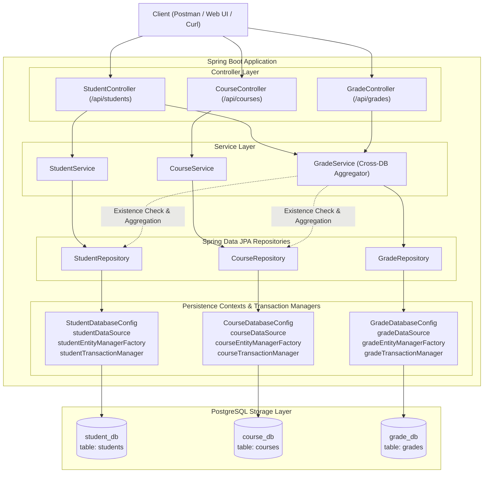

# Laboratory Work No. 8: University Management System

**Discipline:** Development of Web Applications in Java Spring  
**Architecture:** Multi-Database Architecture with Spring Boot, Spring Data JPA, and REST Controllers  
**Target Java Version:** Java 21 LTS  
**Spring Boot Version:** 3.3.5  

---

## 1. System Architecture Overview

The system implements a layered multi-database architecture in a single Spring Boot application connected to **three independent PostgreSQL databases**:
1. `student_db`: Stores student personal information and academic standing.
2. `course_db`: Stores academic catalog courses, credits, and instructors.
3. `grade_db`: Stores student performance and course evaluations.



> **Important Architectural Note on Logical References:**  
> Cross-database foreign keys are not supported natively in PostgreSQL across distinct databases. Therefore, `student_id` and `course_id` inside `grade_db.grades` are **logical references** (scalar `BIGINT`). The `GradeService` explicitly enforces referential integrity at the application layer by verifying the existence of student and course records before committing writes.

---

## 2. Database Schemas

### 2.1 `student_db`
```sql
CREATE TABLE students (
    id BIGINT GENERATED ALWAYS AS IDENTITY PRIMARY KEY,
    first_name VARCHAR(100) NOT NULL,
    last_name VARCHAR(100) NOT NULL,
    email VARCHAR(150) NOT NULL UNIQUE,
    major VARCHAR(100) NOT NULL,
    enrollment_year INTEGER NOT NULL
);
```

### 2.2 `course_db`
```sql
CREATE TABLE courses (
    id BIGINT GENERATED ALWAYS AS IDENTITY PRIMARY KEY,
    course_name VARCHAR(150) NOT NULL,
    course_code VARCHAR(50) NOT NULL UNIQUE,
    credits INTEGER NOT NULL,
    instructor VARCHAR(100) NOT NULL
);
```

### 2.3 `grade_db`
```sql
CREATE TABLE grades (
    id BIGINT GENERATED ALWAYS AS IDENTITY PRIMARY KEY,
    student_id BIGINT NOT NULL, -- Logical reference to student_db.students(id)
    course_id BIGINT NOT NULL,  -- Logical reference to course_db.courses(id)
    score DOUBLE PRECISION NOT NULL CHECK (score >= 0 AND score <= 100),
    letter_grade VARCHAR(5) NOT NULL,
    graded_at TIMESTAMP WITH TIME ZONE NOT NULL DEFAULT CURRENT_TIMESTAMP
);

CREATE INDEX idx_grades_student_id ON grades(student_id);
CREATE INDEX idx_grades_course_id ON grades(course_id);
```

---

## 3. Project Structure

```
lab8-multidatabase/
├── pom.xml
├── docker-compose.yml
├── sql/
│   ├── 01-student_db.sql
│   ├── 02-course_db.sql
│   ├── 03-grade_db.sql
│   └── init-all.sql
├── docker-init/
│   └── init.sh
├── University_Management_System.postman_collection.json
├── src/
│   ├── main/
│   │   ├── java/com/university/
│   │   │   ├── UniversityManagementApplication.java
│   │   │   ├── config/
│   │   │   │   ├── StudentDatabaseConfig.java
│   │   │   │   ├── CourseDatabaseConfig.java
│   │   │   │   └── GradeDatabaseConfig.java
│   │   │   ├── student/
│   │   │   │   ├── entity/Student.java
│   │   │   │   ├── repository/StudentRepository.java
│   │   │   │   ├── service/StudentService.java
│   │   │   │   └── controller/StudentController.java
│   │   │   ├── course/
│   │   │   │   ├── entity/Course.java
│   │   │   │   ├── repository/CourseRepository.java
│   │   │   │   ├── service/CourseService.java
│   │   │   │   └── controller/CourseController.java
│   │   │   ├── grade/
│   │   │   │   ├── entity/Grade.java
│   │   │   │   ├── repository/GradeRepository.java
│   │   │   │   ├── service/GradeService.java
│   │   │   │   └── controller/GradeController.java
│   │   │   ├── dto/
│   │   │   │   ├── StudentRequest.java
│   │   │   │   ├── StudentResponse.java
│   │   │   │   ├── CourseRequest.java
│   │   │   │   ├── CourseResponse.java
│   │   │   │   ├── GradeRequest.java
│   │   │   │   ├── GradeResponse.java
│   │   │   │   ├── CourseGradeDetailDto.java
│   │   │   │   ├── StudentTranscriptDto.java
│   │   │   │   └── ErrorResponse.java
│   │   │   └── exception/
│   │   │       ├── ResourceNotFoundException.java
│   │   │       ├── DuplicateResourceException.java
│   │   │       ├── InvalidDataException.java
│   │   │       └── GlobalExceptionHandler.java
│   │   └── resources/
│   │       ├── application.properties
│   │       └── application.properties.example
│   └── test/
│       ├── java/com/university/
│       │   └── UniversityManagementSystemIntegrationTest.java
│       └── resources/
│           └── application-test.properties
```

---

## 4. Setup and Execution Guide

### Prerequisites: Local Credentials (No Hardcoded Passwords)
Copy `.env.example` to `.env` (already in `.gitignore`) and set your PostgreSQL credentials:
```bash
cp .env.example .env
```
Or pass `DB_USERNAME` / `DB_PASSWORD` directly as environment variables.

### Option A: Using Docker Compose (Recommended)
1. Ensure Docker is running and `.env` (or `POSTGRES_PASSWORD`) is configured.
2. Start the multi-database PostgreSQL container:
   ```bash
   docker compose up -d
   ```
   This automatically provisions `student_db`, `course_db`, and `grade_db` with required tables and indexes.
3. Run the Spring Boot application:
   ```bash
   ./mvnw spring-boot:run
   ```

### Option B: Using an Existing Local PostgreSQL Instance
1. Run the initialization scripts using `psql`:
   ```bash
   psql -U postgres -f sql/init-all.sql
   psql -U postgres -d student_db -f sql/01-student_db.sql
   psql -U postgres -d course_db -f sql/02-course_db.sql
   psql -U postgres -d grade_db -f sql/03-grade_db.sql
   ```
2. Provide your credentials via `.env` or environment variables:
   ```powershell
   $env:DB_USERNAME="postgres"
   $env:DB_PASSWORD="your_password"
   ./mvnw.cmd spring-boot:run
   ```

### Option C: Automated In-Memory Test Suite (Zero Setup)
Run the automated integration test suite covering CRUD, `400`/`404`/`409` validation, and transcript aggregation:
```bash
./mvnw clean test
```

---

## 5. REST API Specification

### 5.1 Student Endpoints
| Method | Endpoint | Description | Status Code |
|---|---|---|---|
| `GET` | `/api/students` | List all students | `200 OK` |
| `GET` | `/api/students/{id}` | Get student by ID | `200 OK` / `404 Not Found` |
| `POST` | `/api/students` | Create new student | `201 Created` / `400` / `409 Conflict` |
| `PUT` | `/api/students/{id}` | Update existing student | `200 OK` / `404` / `409 Conflict` |
| `DELETE` | `/api/students/{id}` | Delete student | `204 No Content` / `404 Not Found` |
| `GET` | `/api/students/{id}/transcript` | Cross-DB Aggregated Transcript | `200 OK` / `404 Not Found` |

### 5.2 Course Endpoints
| Method | Endpoint | Description | Status Code |
|---|---|---|---|
| `GET` | `/api/courses` | List all courses | `200 OK` |
| `GET` | `/api/courses/{id}` | Get course by ID | `200 OK` / `404 Not Found` |
| `POST` | `/api/courses` | Create new course | `201 Created` / `400` / `409 Conflict` |
| `PUT` | `/api/courses/{id}` | Update existing course | `200 OK` / `404` / `409 Conflict` |
| `DELETE` | `/api/courses/{id}` | Delete course | `204 No Content` / `404 Not Found` |

### 5.3 Grade Endpoints
| Method | Endpoint | Description | Status Code |
|---|---|---|---|
| `POST` | `/api/grades` | Assign grade (verifies student & course exist) | `201 Created` / `400` / `404 Not Found` |
| `GET` | `/api/grades/student/{id}` | List grades for specific student | `200 OK` / `404 Not Found` |

---

## 6. Sample Requests & Responses

### 6.1 Create Student
```bash
curl -X POST http://localhost:8080/api/students \
  -H "Content-Type: application/json" \
  -d '{
    "firstName": "Alan",
    "lastName": "Turing",
    "email": "alan.turing@university.edu",
    "major": "Computer Science",
    "enrollmentYear": 2023
  }'
```
**Response (201 Created):**
```json
{
  "id": 1,
  "firstName": "Alan",
  "lastName": "Turing",
  "email": "alan.turing@university.edu",
  "major": "Computer Science",
  "enrollmentYear": 2023
}
```

### 6.2 Assign Grade with Cross-Database Validation
```bash
curl -X POST http://localhost:8080/api/grades \
  -H "Content-Type: application/json" \
  -d '{
    "studentId": 1,
    "courseId": 1,
    "score": 95.0
  }'
```
**Response (201 Created):**
```json
{
  "id": 1,
  "studentId": 1,
  "courseId": 1,
  "score": 95.0,
  "letterGrade": "A",
  "gradedAt": "2026-11-08T16:15:00Z"
}
```

### 6.3 Final Challenge: Unified Academic Transcript (`/api/students/{id}/transcript`)
```bash
curl -X GET http://localhost:8080/api/students/1/transcript
```
**Response (200 OK):**
```json
{
  "studentId": 1,
  "studentName": "Alan Turing",
  "email": "alan.turing@university.edu",
  "major": "Computer Science",
  "enrollmentYear": 2023,
  "courses": [
    {
      "courseId": 1,
      "courseName": "Distributed Systems",
      "courseCode": "CS401",
      "credits": 4,
      "instructor": "Dr. Leslie Lamport",
      "score": 95.0,
      "letterGrade": "A",
      "gradedAt": "2026-11-08T16:15:00Z"
    },
    {
      "courseId": 2,
      "courseName": "Database Systems",
      "courseCode": "CS301",
      "credits": 3,
      "instructor": "Dr. Edgar Codd",
      "score": 85.0,
      "letterGrade": "B",
      "gradedAt": "2026-11-08T16:16:00Z"
    }
  ],
  "averageScore": 90.0,
  "totalCredits": 7
}
```

---

## 7. Oral Defense & Theoretical Questions

### Question 1: Why do ordinary local JPA transactions not provide atomicity across three databases?
1. **Local Transaction Boundary:**  
   In Spring Boot with multiple data sources, each database is configured with its own `PlatformTransactionManager` (`JpaTransactionManager`). When a method is annotated with `@Transactional(transactionManager = "gradeTransactionManager")`, the transaction manager only intercepts and controls connection lifecycle (`begin`, `commit`, `rollback`) for that **specific database connection**.
2. **Dual-Write / Multi-Write Problem:**  
   If a single service method performs a mutation in `student_db` and subsequently attempts a mutation in `grade_db`:
   - Spring cannot bind two physical database connections to a single local transaction.
   - If `student_db` commits successfully and an error occurs during the commit of `grade_db`, `student_db` **cannot be automatically rolled back**.
   - The system is left in an inconsistent state (partial write).
3. **Architectural Solutions:**  
   - **Two-Phase Commit (2PC / XA):** Uses a distributed transaction manager (e.g., Atomikos, Narayana, Bitronix) coordinating prepare and commit phases across resource managers. While guaranteeing ACID, 2PC introduces latency, resource locking, and reduced availability (blocking protocol).
   - **Saga Pattern:** Decomposes distributed workflows into local transactions with asynchronous messaging and compensating transactions (undo actions) to achieve **Eventual Consistency**.
   - **Transactional Outbox Pattern:** Combines local database commits with an event log to reliably publish cross-service domain events.

---

### Question 2: What are the consistency risks when one database is unavailable?
1. **Cascading Failure & Read Degradation:**  
   When generating an academic transcript (`GET /api/students/{id}/transcript`), the application must query all three databases. If `course_db` is offline:
   - A naive synchronous join fails completely, throwing a 500 error to the client.
   - A resilient design degrades gracefully: returns the student information and grade scores with course placeholders (`Unknown Course [ID: x]`), maintaining high availability.
2. **Orphaned Records (Referential Integrity Loss):**  
   Because cross-database foreign key constraints do not exist in the database engine, if `student_db` deletes a student while `grade_db` is unreachable, `grade_db` is left with orphaned grade rows referencing a deleted student ID.
3. **Write Availability Bottleneck:**  
   When inserting a grade (`POST /api/grades`), the application must synchronously verify that `student_id` exists in `student_db` and `course_id` exists in `course_db`. If either `student_db` or `course_db` is down, grade registration is blocked even though `grade_db` itself is completely healthy.

---

## 8. Team Contribution & Defense Checklist

| Team Member | Contribution Area |
|---|---|
| Member 1 | Multi-DataSource JPA Configuration (`StudentDatabaseConfig`, `CourseDatabaseConfig`, `GradeDatabaseConfig`), Docker Compose setup |
| Member 2 | Student & Course domain entities, repositories, services, and CRUD REST controllers with `@Valid` constraints |
| Member 3 | Grade module, cross-database existence validation, unified transcript aggregation (`StudentTranscriptDto`), Postman collection & defense documentation |
